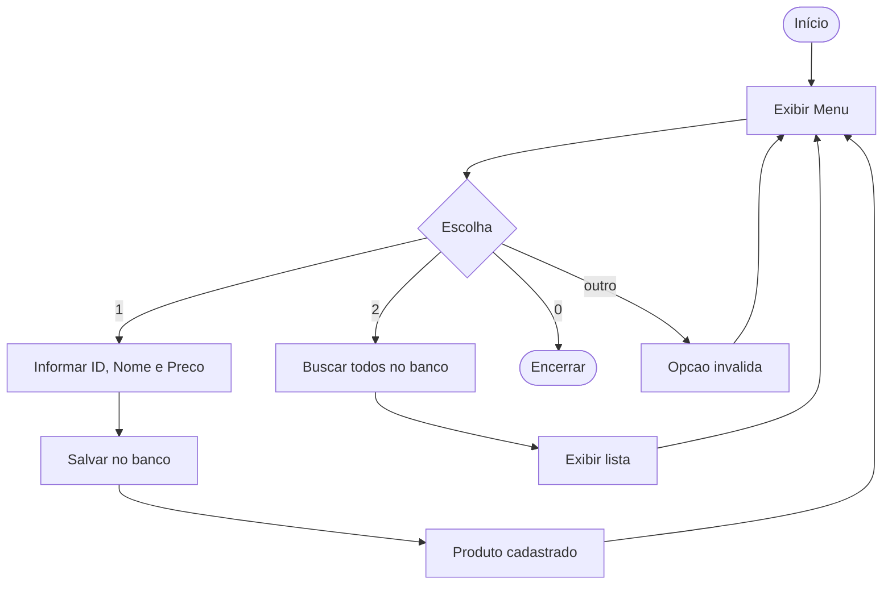

# cadastro-produtos-cli


Aplicação **CLI** (linha de comando) para gerenciamento de produtos, construída com Spring Boot e persistência em PostgreSQL via Spring Data JPA.

---

## Funcionalidades

- Cadastrar produto (ID, nome, preço)
- Listar todos os produtos
- Buscar produto por ID

---

## Fluxo da Aplicação



---

## Stack

| Camada       | Tecnologia              |
|--------------|-------------------------|
| Linguagem    | Java 21                 |
| Framework    | Spring Boot 3.2.2       |
| Persistência | Spring Data JPA         |
| Banco        | PostgreSQL              |
| Utilitários  | Lombok                  |
| Interface    | Scanner (CLI)           |

---

## Modelo de Dados

```
db_produto
├── id    (int, PK)
├── nome  (String)
└── preco (double)
```

---

## Como Executar

### Pré-requisitos

- Java 21+
- Maven 3.9+
- PostgreSQL em execução

### Variáveis de Ambiente

| Variável               | Padrão                                  |
|------------------------|-----------------------------------------|
| `DB_URL`               | `jdbc:postgresql://localhost:5432/postgres` |
| `DB_USERNAME`          | `postgres`                              |
| `DB_PASSWORD`          | `changeme`                              |

### Executar

```bash
# Clonar
git clone https://github.com/odavid062/atvRafael.git
cd atvRafael

# Configurar variáveis (opcional)
export DB_URL=jdbc:postgresql://localhost:5432/postgres
export DB_USERNAME=postgres
export DB_PASSWORD=sua_senha

# Compilar e rodar
mvn spring-boot:run
```

---

## Autor

**David Rodrigues** — [GitHub](https://github.com/odavid062) · [LinkedIn](https://www.linkedin.com/in/david-rodrigues-00b988214)
